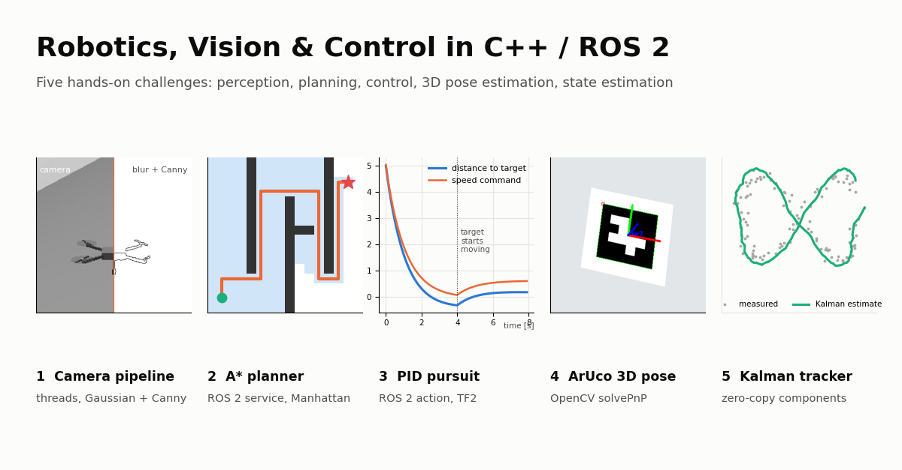

# Robotics, Vision & Control: 5 C++ / ROS 2 Challenges




*Illustrations generated with the same algorithms and parameters as the code below (Gaussian 5x5 +
Canny 50/150, 4-connected A* with a Manhattan heuristic, PID 1.0 / 0.1 / 0.01 at 10 Hz, DICT_4X4_50
+ solvePnP, constant-velocity Kalman filter) on example data.*

Five C++ / ROS 2 / OpenCV exercises, each built around one robotics software topic: multithreading
and memory safety, a planner exposed as a ROS 2 service, an asynchronous control loop as a ROS 2
action, 3D pose estimation from a camera, and a Kalman filter in composed nodes with zero-copy
intra-process transport.

---

## 🛠️ Build & Run Instructions

```bash
# Create a workspace
mkdir -p ~/ros2_challenges_ws/src
cd ~/ros2_challenges_ws/src

# Clone the repository
git clone https://github.com/NicoC54/Robotics-Vision-Control-Challenges.git

# Build the workspace
cd ..
colcon build --symlink-install
source install/setup.bash

```

---

## 🧠 The Challenges

### ✅ Level 1: The Perception Pipeline (Pure C++, Threading & Polymorphism)

**Objective:** Design the software core of a camera node. It continuously captures images in one thread while applying a "Plug & Play" sequence of filters (e.g., Gaussian Blur, Canny) in another.

* **Engineering Focus:** Multithreading, Mutexes, and memory safety.
* **Source Code:** [View perception_pipeline/src](https://github.com/NicoC54/Robotics-Vision-Control-Challenges/tree/main/ros_ws/src/perception_pipeline/src)

---

### ✅ Level 2: The A* Path Planner (C++ STL, Big O & ROS 2 Services)

**Objective:** A complete ROS 2 Service/Client architecture. The node exposes a `GetPath` Service taking a 2D occupancy grid, a start point, and a goal, computing the shortest path using the A* algorithm. The Client node sends the request and processes the trajectory.

* **Engineering Focus:** Algorithmic optimization and strict C++ Standard Template Library (STL) container selection.
* **Source Code:** [View astar_service/src](https://github.com/NicoC54/Robotics-Vision-Control-Challenges/tree/main/ros_ws/src/astar_service/src)

---

### ✅ Level 3: The Pursuit Controller (ROS 2 Actions, PID & TF2)

**Objective:** A ROS 2 Action Server for a mobile robot. Given a "Follow Object X" goal, the server continuously listens to the TF2 tree to compute the distance to the target, applies a PID controller to the distance error, and streams the resulting speed command as action feedback.

* **Engineering Focus:** Asynchronous control loops and automatic control theory.
* **Source Code:** [View action_pid/src](https://github.com/NicoC54/Robotics-Vision-Control-Challenges/tree/main/ros_ws/src/action_pid/src)

---

### ✅ Level 4: The 3D Pose Estimator (OpenCV, TF2 Broadcaster, Quaternions)

**Objective:** Extract 3D spatial data from a 2D image. The node detects an ArUco marker, uses the camera's intrinsic matrix to compute its 3D pose via `solvePnP`, and broadcasts it to the ROS 2 network.

* **Engineering Focus:** Spatial vision and 3D mathematics.
* **Source Code:** [View aruco_node/src](https://github.com/NicoC54/Robotics-Vision-Control-Challenges/tree/main/ros_ws/src/aruco_node/src)

---

### ✅ Level 5: Zero-Copy State Estimator (Kalman Filter, QoS, Intra-process)

**Objective:** Two ROS 2 Component Nodes (a Publisher and a Subscriber) running in the same process. Node A publishes camera frames. Node B subscribes, reads the image in Zero-Copy mode, extracts a noisy 2D position, and filters it through a Linear Kalman Filter to predict the true state.

* **Engineering Focus:** IPC (Inter-Process Communication), ROS 2 Node Composition, and Sensor Fusion.
* **Source Code:** [View tracker_kalman/src](https://github.com/NicoC54/Robotics-Vision-Control-Challenges/tree/main/ros_ws/src/tracker_kalman/src)

---

## 📫 Let's Connect

I am currently seeking full-time opportunities as a **Robotics Software Engineer** or **Computer Vision Engineer**.
